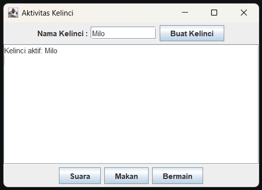
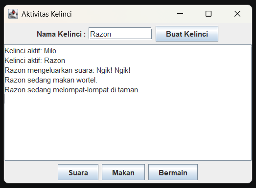
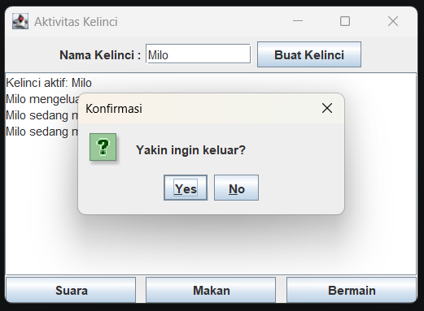
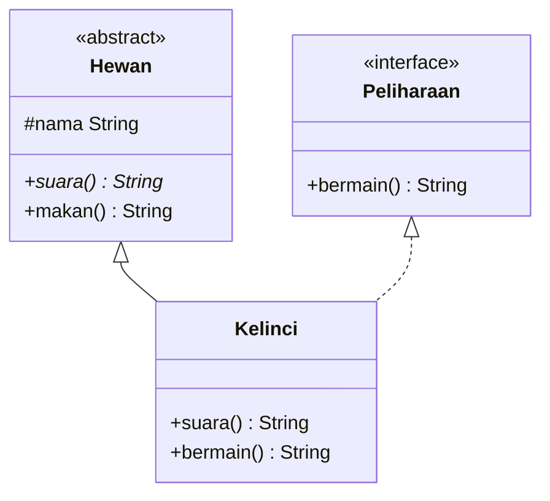

# Aktivitas Kelinci - GUI Java Swing

Aplikasi GUI sederhana berbasis **Java Swing** yang menampilkan aktivitas seekor kelinci (bersuara, makan, dan bermain). Program ini dibuat untuk mempraktikkan konsep **Pemrograman Berorientasi Objek (PBO)**: *Interface*, *Abstract Class*, *Abstract Method*, dan *Concrete Class*, serta **GUI dan Event Handling** pada Java.

## Tampilan Program

| Saat program dibuka | Setelah nama diganti dan tombol diklik |
|:---:|:---:|
|  |  |

Dialog konfirmasi saat jendela ditutup (Event Adapter `WindowAdapter`):



## Fitur

- Mengganti nama kelinci lewat kolom input, lalu klik **Buat Kelinci**.
- Tombol **Suara**, **Makan**, dan **Bermain** untuk menjalankan aktivitas kelinci.
- Semua hasil aktivitas ditampilkan secara berurutan di area teks.
- Validasi sederhana: nama yang kosong tidak diterima.
- Dialog konfirmasi saat jendela ditutup.

## Komponen Utama GUI
Program ini menggunakan 5 komponen utama GUI pada Java Swing, sesuai latihan eksplorasi GUI.

| No | Komponen | Class / Interface | Digunakan pada program | Fungsi |
|---|---|---|---|---|
| 1 | **Top-level Container** | `JFrame` | `frame` dengan judul "Aktivitas Kelinci"; dialog konfirmasi memakai `JOptionPane` | Jendela utama aplikasi tempat semua komponen diletakkan |
| 2 | **Intermediate Container** | `JPanel`, `JScrollPane` | `atas` (input nama), `bawah` (tombol), dan scroll pada area teks | Mengelompokkan komponen; `JScrollPane` membuat area teks bisa digulir |
| 3 | **Atomic Component** | `JLabel`, `JTextField`, `JButton`, `JTextArea` | label "Nama Kelinci", kolom nama, 4 tombol, dan area log | Komponen yang langsung berinteraksi dengan pengguna |
| 4 | **Layout** | `BorderLayout`, `FlowLayout`, `GridLayout` | `BorderLayout` pada content pane `JFrame` (NORTH, CENTER, SOUTH); `FlowLayout` pada panel input nama; `GridLayout` pada panel tombol | Mengatur posisi komponen di dalam container |
| 5 | **Event Listener** | `ActionListener` (interface), `WindowAdapter` (adapter class), `ActionEvent`, `WindowEvent` | `ButtonHandler` meng-override `actionPerformed()`; `CloseHandler` meng-override `windowClosing()` | Menangani klik tombol dan penutupan jendela |

Potongan kode Event Listener:

```java
private class ButtonHandler implements ActionListener {
    @Override
    public void actionPerformed(ActionEvent e) {
        Object sumber = e.getSource();
        if (sumber == btnSuara) {
            areaLog.append(kelinciku.suara() + "\n");
        }
        // ... tombol lainnya
    }
}

// didaftarkan ke tombol
btnSuara.addActionListener(handler);
```

Potongan kode Event Adapter:

```java
private class CloseHandler extends WindowAdapter {
    @Override
    public void windowClosing(WindowEvent e) {
        int pilihan = JOptionPane.showConfirmDialog(frame, "Yakin ingin keluar?",
                "Konfirmasi", JOptionPane.YES_NO_OPTION);
        if (pilihan == JOptionPane.YES_OPTION) {
            System.exit(0);
        }
    }
}

// didaftarkan ke frame
frame.addWindowListener(new CloseHandler());
```

## Konsep OOP yang Digunakan

| Konsep | Di dalam kode | Penjelasan |
|---|---|---|
| **Interface** | `Peliharaan` | Kontrak yang mewajibkan method `bermain()` |
| **Abstract Class** | `Hewan` | Kerangka dasar hewan, menyimpan atribut `nama` |
| **Abstract Method** | `suara()` di `Hewan` | Tidak punya isi, wajib diimplementasikan subclass |
| **Concrete Method** | `makan()` di `Hewan` | Method biasa yang sudah punya isi |
| **Concrete Class** | `Kelinci` | Turunan `Hewan` sekaligus implementasi `Peliharaan` |



## Cara Menjalankan

**Prasyarat:** sudah terpasang **JDK** (Java Development Kit).

```bash
# 1. Clone repository
git clone https://github.com/<username>/<nama-repository>.git
cd <nama-repository>

# 2. Compile
javac Main.java

# 3. Jalankan
java Main
```

Bisa juga dijalankan lewat **VS Code** (dengan *Extension Pack for Java*): buka `Main.java`, lalu klik **Run** di atas method `main`.

## Contoh Output

Setelah nama diganti menjadi `Razon`, lalu tombol **Suara**, **Makan**, dan **Bermain** diklik secara berurutan:

```
Kelinci aktif: Milo
Kelinci aktif: Razon
Razon mengeluarkan suara: Ngik! Ngik!
Razon sedang makan wortel.
Razon sedang melompat-lompat di taman.
```

## Pembuat

- **Nama:** (Rila Yayu Wahyuningsih)
- **NIM:** (F1D02510024)
- **Mata Kuliah:** Pemrograman Berorientasi Objek (PBO)
